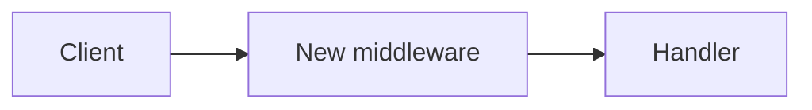

# Create Pull Request

Open a well-formed GitHub PR that matches the repository's conventions and links its issues correctly.

## When to use

The user has committed work on a branch and wants to open it for review, or asks anything like "create a PR", "open a pull request", "raise a PR for this". If work isn't committed yet, commit it first (only when the user wants that) before continuing.

## Workflow

### 1. Gather context

Under T3 Code the PR-linking tools are deferred. If `link_pull_request` appears in the deferred tool list, load it and `list_thread_pull_requests` with one `ToolSearch` call before anything else, using the exact names from that list (they carry a harness prefix):

```
select:mcp__t3-code__link_pull_request,mcp__t3-code__list_thread_pull_requests
```

Do this once per session. A loaded schema stays loaded, so never search for either tool again. Outside T3 neither tool exists; skip this and the linking in step 8.

Run these to understand the state of the branch:

```bash
gh pr view --json url,state,isDraft 2>/dev/null
git branch --show-current
git log --oneline origin/HEAD..HEAD 2>/dev/null || git log --oneline -10
git diff --stat origin/HEAD...HEAD 2>/dev/null || git diff --stat
```

If a PR already exists for this branch, stop and tell the user — update it rather than opening a duplicate.

Read the actual diff (`git diff origin/HEAD...HEAD`) so the PR description reflects what truly changed — not a guess. The diff tells you *what* changed; the user's original prompt tells you *why it mattered*. You need both.

### 2. Find the PR template

Look for the repository's template, checking these paths in order (GitHub recognizes all of them, case-insensitively):

- `.github/PULL_REQUEST_TEMPLATE.md`
- `.github/pull_request_template.md`
- `PULL_REQUEST_TEMPLATE.md`
- `docs/PULL_REQUEST_TEMPLATE.md`
- `.github/PULL_REQUEST_TEMPLATE/` (a directory of multiple templates — if present, pick the most relevant or ask the user)

```bash
ls .github/PULL_REQUEST_TEMPLATE.md .github/pull_request_template.md PULL_REQUEST_TEMPLATE.md docs/PULL_REQUEST_TEMPLATE.md 2>/dev/null
```

If a template exists, use it verbatim as the structure and fill in its sections from the diff. The repo's own template always wins over the default — it encodes that team's conventions.

If none exists, use the default template in `assets/default_template.md`.

### 3. Fill out the template

Populate the template honestly from the diff and commits:

- Check the boxes that apply (PR type, testing done). Don't check testing boxes for tests you can't confirm ran — leave them unchecked or note what's still needed.
- Only claim things the diff supports. An empty section is better than an invented one.
- Leave the screenshots section to step 7.

Open the description with a plain statement of the problem, drawn from the user's original prompt, then briefly explain the solution. Never lead with an inventory of what you deleted and renamed — that's the part a reviewer can read from the diff.

BAD
> ❌ Removed implicit workspace carry-over from every "new thread" entry point (cmd+n, sidebar v1/v2 buttons, command palette). New threads inherit only the project from context. Deleted `buildContextualThreadOptions`, `startNewThreadInProjectFromContext`, and the v1 sidebar's seed-context machinery.

GOOD
> ✅ Starting a new thread from an existing worktree silently ignored your "new worktree" default and reused the current one. Now new threads always take branch, worktree, and env mode from your configured defaults, and only inherit the project.

Close the body with a short line naming the model and harness that made the change.

### 4. Link issues so merging closes them

If the branch came from a GitHub issue, or the user mentions an issue number, wire up closing keywords so the issue auto-closes when the PR merges. Use GitHub's closing keywords, one issue per keyword:

```
Closes #123
Closes #456
```

To detect the issue, check the branch name (e.g. `feature/123-add-auth`, `fix/issue-456`) and ask the user if ambiguous. Put the `Closes #N` lines in the PR body (the default template has a `Closes #` line under Description for this). For multiple issues, use a separate `Closes #N` for each — `Closes #1, #2` does **not** close both.

### 5. Check the documentation still matches

Run this step on every PR. A PR that changes behaviour but leaves the docs describing the old behaviour ships a bug for the next reader. Before opening it, check the docs the diff invalidates and update them in the same PR.

Start from the repo's own instructions (`CLAUDE.md`, `AGENTS.md`, `CONTRIBUTING.md`) — they usually name the files that must move with a change, and those win over this list. Then look for anything the diff touches:

- `README.md` — commands, install steps, tables of features/plugins/packages, project layout
- `CLAUDE.md` / `AGENTS.md` — architecture, scripts, conventions you changed
- Harness documentation (`CLAUDE.md`, `CONTEXT.md`, `docs/ARCHITECTURE.md` and the other strategic docs, ADRs) — only if the repo already has these files. Run the `harness-documentation` skill to update the existing ones against the diff, and leave any missing ones uncreated: scaffolding a doc tree is a separate change. If the skill isn't installed, update the existing files by hand.
- `docs/` and any per-package or per-plugin README
- Generated or manifest files that must be rebuilt (run the repo's build/codegen script rather than hand-editing them)
- Doc comments and examples next to the code you changed

A quick way to find stale references to something you renamed or removed:

```bash
git diff origin/HEAD...HEAD --stat
grep -rn "<old name or command>" --include="*.md" .
```

Update what's genuinely stale, and nothing else — an unrelated docs sweep makes the PR harder to review. If a doc needs a change you shouldn't make here (a decision for the user, or a big rewrite), say so in the PR body and tell the user rather than leaving it silently wrong.

If the diff now includes docs, check the **Documentation** box in the PR type section.

### 6. Add a mermaid diagram only when it earns its place

**Default to no diagram.** Most PRs don't need one, and a diagram that restates the prose next to it makes the description longer without making it clearer.

Add one only when the change has structure that prose genuinely struggles with:

- A request or data path crossing several components
- A state machine, or a lifecycle with non-obvious transitions
- A control-flow or architecture change where *what moved* is the point
- A fan-out / fan-in where the branching is the thing being reviewed

Skip it when:

- The diff is one file, or purely textual — docs, copy, config, a version bump
- The change is a straight line (A then B then C) — a sentence is shorter and clearer
- You already explained the same relationship in prose. Pick one, not both.
- The nodes would just be the names of the files you touched

If you can't name the question the diagram answers, don't include it.

#### Always quote node labels

**`A["label"]`, never `A[label]`.** This is not style — an unquoted label containing `@` is a hard parse error on GitHub:

```
Parse error on line 2:
...pnpm.overrides] --> B[brace-expansion@1
-----------------------^
Expecting 'AMP', 'COLON', 'PIPE', ..., got 'LINK_ID'
```

Mermaid 11 gave `@` grammar meaning (edge IDs, and `A@{shape: ...}` metadata), so in an unquoted label it lexes as `LINK_ID` instead of text. GitHub renders with mermaid 11; mermaid 10 accepted it, which is why this can pass a local check against an older version and still fail on the PR.

It bites the labels you most want in a dependency or package diagram — `pkg@1`, `@scope/pkg`, `a@b.com` — and it fails identically in square, round, and edge-pipe labels. Quoting fixes all of them:

| Breaks | Works |
|---|---|
| `A[brace-expansion@1]` | `A["brace-expansion@1"]` |
| `A(@scope/pkg)` | `A("@scope/pkg")` |
| `A -->\|pkg@1\| B` | `A -->\|"pkg@1"\| B` |

Quoting every label costs nothing and removes the whole class, so do it unconditionally rather than scanning for `@`.

Verified fine unquoted, for reference — don't contort labels to avoid these: `<br/>`, non-ASCII (`→`, `·`), and `^`.

````

````

#### Validate before creating the PR

A broken diagram is worse than none — GitHub shows a red "Unable to render rich display" box on a public PR, and only reports the error after it's already there. Parse it locally first. **Pin mermaid 11** to match GitHub; validating against 10 gives a false pass:

```bash
cd "$(mktemp -d)" && bun add mermaid@11 happy-dom >/dev/null 2>&1
# write the diagram body (no fences) to d.mmd, then parse it
bun -e 'import{Window}from"happy-dom";const w=new Window({url:"https://localhost"});Object.assign(globalThis,{window:w,document:w.document});const m=(await import("mermaid")).default;m.initialize({startOnLoad:false});await m.parse(await Bun.file("d.mmd").text());console.log("valid")'
```

If it doesn't print `valid`, fix it or drop the diagram. Never ship an unvalidated diagram.

### 7. Attach screenshots when the change is visible

A reviewer can read a diff, but they can't see a layout change without running the branch. Attach screenshots only when every gate below passes, and check them in order:

1. **Visible.** The diff changes what someone sees in a browser or app UI: components, styles, page templates, on-screen copy, or a layout. The user asking for screenshots also passes this gate. Markdown, PR or issue templates, CLI output, emails, APIs, backend, tooling, config, tests, and refactors that leave the screen pixel-identical do not. When in doubt, ask: what would the screenshot show that the description doesn't?
2. **Supported.** This `gh` can upload attachments (added in 2.99), and the repo is hosted where uploads work:

   ```bash
   gh pr create --help | grep -q -- '--attach' && echo supported
   gh repo view --json url --jq .url
   ```

   The first command must print `supported`. The URL's host must be `github.com` or end in `.ghe.com`. Any other host, such as GitHub Enterprise Server, fails the gate.
3. **Runnable.** You can start the app locally against local or seeded data. Production, staging and any shared environment are off limits for capture.

If a gate fails, or no image survives the checks in the reference, open the PR without screenshots. Pass no `--attach`, and say which gate failed in your reply to the user. For an old `gh`, tell them to upgrade it (`brew upgrade gh` on macOS) and that the PR can get images later. Never hand-roll an upload through the API or a browser session.

When every gate passes, follow [`references/screenshots.md`](references/screenshots.md) to capture, check and reference the images. With no images, delete the screenshots section from the default template rather than leaving it empty. In a repo's own template, keep the section and write "No UI changes".

### 8. Create the PR

Before pushing, check the title, body, quotes and screenshots for secrets and private details (tokens, internal hostnames, personal data).

Push the branch and create the PR with `gh`. Write the body to a temp file to preserve formatting:

```bash
git push -u origin HEAD
gh pr create --title "<title>" --body-file /tmp/pr_body.md
```

With screenshots from step 7, add one `--attach <file>` per image, using the same path the body references. If `gh pr create` exits non-zero, assume the PR may already exist and never rerun the create, because that opens a duplicate:

- If stdout has a PR URL, some uploads failed. Send the whole body again with every image, so all the local paths get rewritten: `gh pr edit <url> --body-file /tmp/pr_body.md --attach <file> ...`.
- If stdout has no URL, run `gh pr list --head "$(git branch --show-current)" --json url` to find out whether the PR was created before you retry anything.
- If it failed because the GraphQL rate limit is used up, confirm no PR exists with `gh api "repos/<owner>/<repo>/pulls?head=<owner>:<branch>"`, then open it through REST, which has its own limit: `gh api repos/<owner>/<repo>/pulls -f title=... -f head=<branch> -f base=<base> -F body=@/tmp/pr_body.md`. Screenshots cannot be attached this way; add them later with `gh pr edit`.

Then confirm no local path is left in the body: `gh pr view <url> --json body --jq .body | grep -c /tmp/pr-shots` should print `0`.

Open a real PR, never a draft — review bots don't run on drafts.

Titles usually become the squashed commit message, so match the repo's convention (check recent PRs with `gh pr list --state all --limit 10` if unsure — e.g. Conventional Commits like `feat(auth): ...`). Within that convention, name the outcome rather than the mechanism:

BAD
> ❌ perf(server): negotiate permessage-deflate on the websocket

GOOD
> ✅ perf(server): cut websocket frame size by 70% with compression

Under T3, call `link_pull_request` with the new URL straight away, then `list_thread_pull_requests` to confirm it is registered. Both schemas are already loaded from step 1. If linking fails, say so rather than claiming the PR is linked.

After creation, show the user the PR URL. If they also asked you to watch it, continue with the `babysit-pr` skill.

## Notes

- If `gh` isn't authenticated (`gh auth status` fails), tell the user to run `gh auth login` rather than failing silently.
- Never invent test results or check boxes for work not done — a reviewer trusts the checklist.
- Match the existing repo conventions over personal preference: title style, label usage, base branch.
